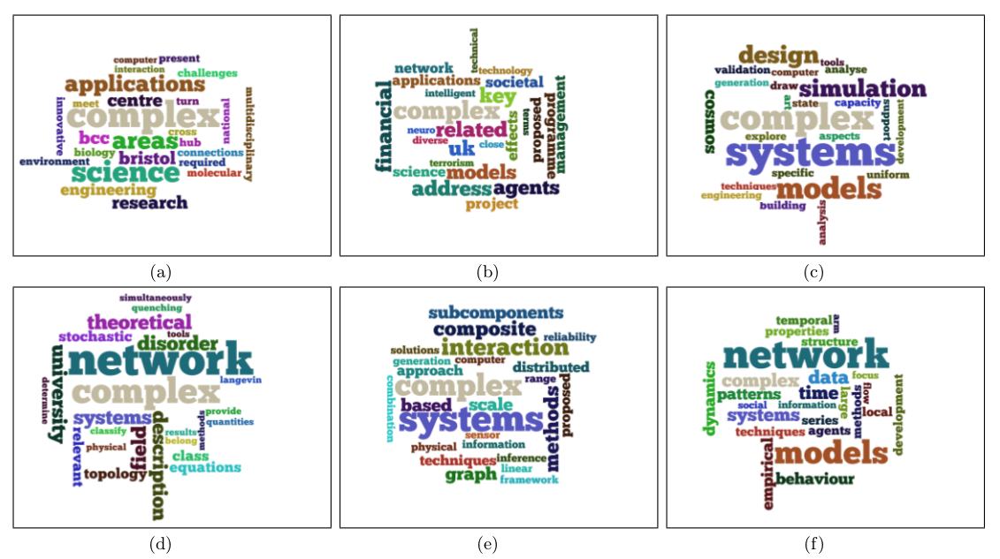

# Word Storm

**Compare documents with coordinated word clouds.** A word storm is a group of
word clouds, one per document. Words that appear in several documents get the
same position, color and angle in every cloud, so similar documents look
similar and what's distinctive stands out.



## Use it

**In your browser:** open the web app, drop in some `.txt` files (one per
document), and download the result as SVG, PNG or JSON. Everything runs
locally; your files never leave your computer.

> The app deploys to GitHub Pages from `master` (see
> [.github/workflows/web.yml](.github/workflows/web.yml)). Until then, run it
> locally as shown below.

Things you can change:

- **Word storm or separate clouds:** coordinated layout, or ordinary
  independent clouds for comparison.
- **Words per cloud** (10–80).
- **Size words by** how often they appear, or by how *distinctive* they are to
  each document (tf-idf).
- **Fade common words:** words that every document uses are drawn lighter.
- **Font:** Oswald (default, a condensed sans that packs tightly), Bricolage
  Grotesque, Anton, Fraunces, Zilla Slab (a slab, like the original's
  ChunkFive), or your system font. All are open-source Google Fonts,
  self-hosted, and embedded in SVG/PNG downloads.
- **Colors:** Storm, Ocean, Sunset, Forest, Midnight (dark), Ink, or Classic
  (the original random colors). Every palette color has at least 3:1
  contrast against its background.
- Words to ignore, cloud shape, and random seed.

Hover a word to highlight it in every cloud; click to pin it.

## Run it locally

Needs [Node.js](https://nodejs.org) 22.18 or newer.

```bash
cd web
npm install
npm run dev
```

Then open http://localhost:5173, or http://localhost:5173/?example to load the
2012 US presidential debates straight away.

| Command | What it does |
|---|---|
| `npm run dev` | Dev server with hot reload |
| `npm test` | Unit and layout tests |
| `npm run typecheck` | TypeScript checks |
| `npm run compare` | Lays out the example data and compares it with the original Java output in [reference/](reference/); writes SVGs to `web/out/` |
| `npm run build` | Production build in `web/dist/` |

## Use it as a library

The layout code has no DOM dependency; give it a way to measure text.

```ts
import { generateStorm, createCanvasMeasurer, stormToSvg } from './web/src/index.ts';

const measurer = createCanvasMeasurer((w, h) => new OffscreenCanvas(w, h));
const storm = generateStorm(
  [
    { name: 'Obama', text: '…' },
    { name: 'Romney', text: '…' },
  ],
  { mode: 'coordinated', maxWords: 25 },
  measurer,
);
const svg = stormToSvg(storm);
```

In Node, pass a canvas from [`@napi-rs/canvas`](https://www.npmjs.com/package/@napi-rs/canvas) instead
(see [web/scripts/compare-reference.ts](web/scripts/compare-reference.ts)).

## How it works

1. **Pick words.** Each document's most frequent words, minus common English
   words like "the" and "and".
2. **Place shared words together.** A word that appears in several documents is
   placed at the average of its positions, cloud by cloud, until positions
   settle.
3. **Refine.** A force layout pulls each shared word toward its position in
   similar documents, pushes overlapping words apart and keeps clouds compact.
4. **Fill in.** Words unique to one document fill the space around them.

[ALGORITHM.md](ALGORITHM.md) has the full spec, including where the port
deliberately differs from the original.

The method is from Quim Castella and Charles Sutton, *Word Storms: Multiples of
Word Clouds for Visual Comparison of Documents*, WWW 2014.

## Repository layout

| Path | What |
|---|---|
| [web/](web/) | The TypeScript implementation and web app |
| [web/src/core/](web/src/core/) | Text processing, collision detection, layout (no DOM) |
| [ALGORITHM.md](ALGORITHM.md) | The algorithm, as implemented |
| [examples/](examples/) | Example documents and images |
| [src/](src/), [library/](library/) | The original Java implementation (built on WordCram and Processing 1.2) |
| [reference/](reference/) | Runs the Java version and saves its layouts as JSON, to check the port against |

### The original Java version

The Java code still works for reproducing the paper's results, but it is no
longer the recommended way to make word storms. Processing 1.2 depends on
`java.applet`, which was removed in JDK 26, so
[reference/run.sh](reference/run.sh) patches in an empty stand-in for those
classes:

```bash
JAVA_HOME=/path/to/jdk ./reference/run.sh
```

## License

Apache 2.0. See [LICENSE.txt](LICENSE.txt). Built originally on
[WordCram](https://github.com/danbernier/WordCram); English stop words from
cue.language by Jonathan Feinberg (Apache 2.0).
