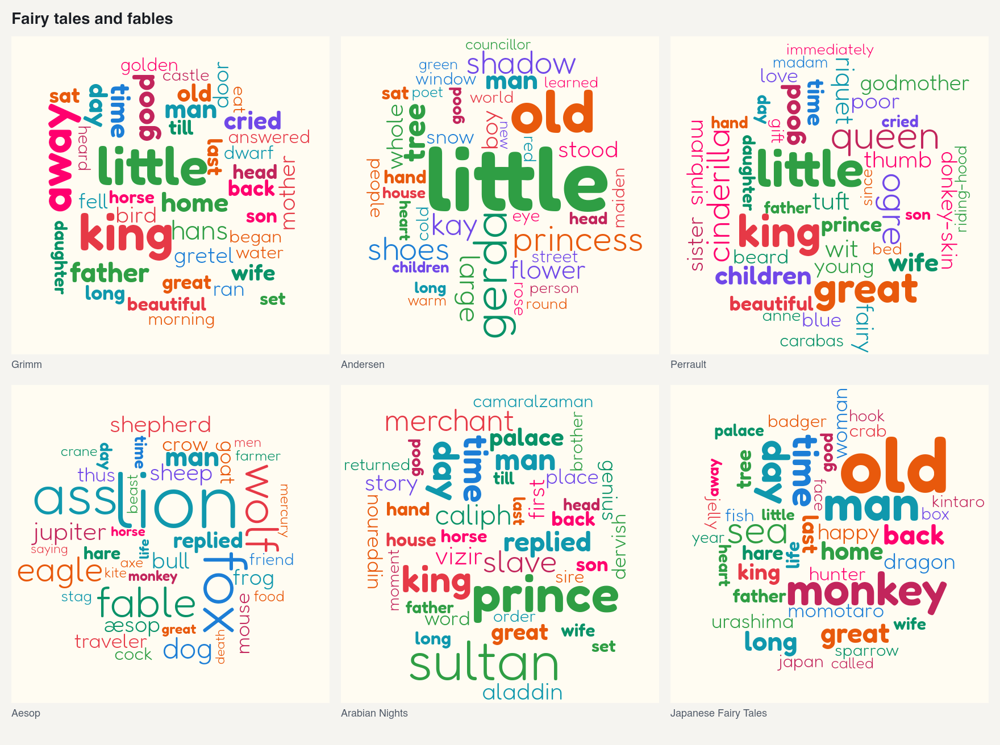
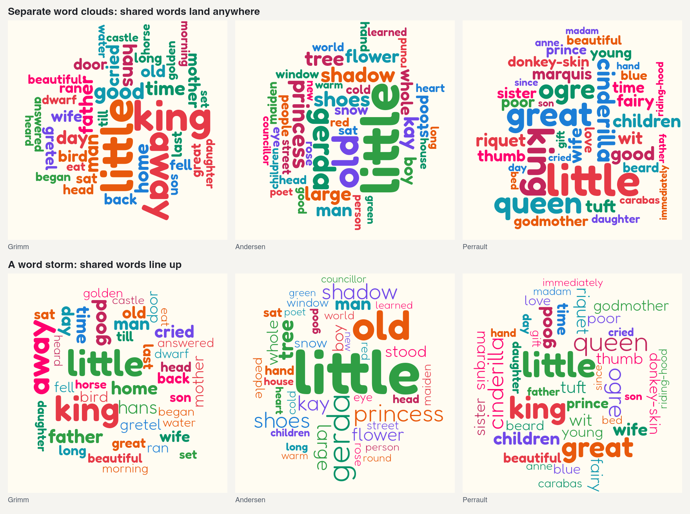
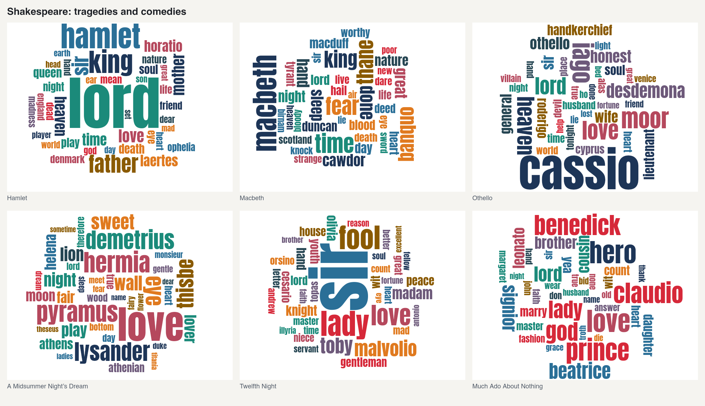

# Word Storms

[](https://www.npmjs.com/package/wordstorms)
[](LICENSE.txt)
[](https://github.com/quimcastella/wordstorms/actions/workflows/web.yml)

**Word clouds that line up, so you can compare documents.** A word storm is a
set of word clouds, one per document, made together. Words the documents share
get similar positions and the same color and angle in every cloud, so you can
see at a glance what the documents have in common and what sets each one
apart. Use it to compare books, chapters, speeches, papers, survey answers or
any other collection of texts.

You can try it at [wordstorms.org](https://wordstorms.org). The site runs in
the browser, so documents are not uploaded anywhere.



Six collections of fairy tales and fables. Bold words are in more than one
collection's cloud and sit in the same spot in each: *little* in Grimm,
Andersen and Perrault, *king* in four of the six. Thin words are in only one
collection's cloud, like the lion, wolf and fox of Aesop's fables. Clouds
that look alike come from collections that use similar words, and a cloud that
looks different comes from a collection that doesn't. Aesop's cloud is almost
all thin words: its fables are about animals, not kings and princesses.

## Why not separate word clouds?



Ordinary word clouds are laid out one at a time. *Little* and *good* are in
all three of these clouds and *king* in two, but in the separate clouds (top)
they land in different places, at different angles and in different colors,
so comparing the clouds means hunting for each word. In the word storm (bottom)
each sits in about the same spot, with the same color and angle, in every
cloud. Your eye can skip what the collections share and go straight to what
differs: Andersen's *Gerda* and *Kay*, Perrault's *ogre* and *Cinderella*.

## Quick start

**In a browser:** go to [wordstorms.org](https://wordstorms.org), pick an
example, or drop in your own `.txt` files or paste text.

**On the command line**, with [Node.js](https://nodejs.org) 22.18 or newer:

```bash
npx wordstorms --example holmes
```

Open `wordstorm/index.html` in your browser to explore the four Sherlock
Holmes novels. To compare your own documents:

```bash
npx wordstorms path/to/folder
```

Each `.txt` or `.md` file becomes a cloud. [Command line](#command-line) lists
every option, and [Use it as a library](#use-it-as-a-library) shows the
TypeScript API.

## Reading a word storm

| What you see | What it means |
|---|---|
| Word size | How much this document uses the word, relative to the other words in its own cloud. Weights are normalized per cloud, so compare sizes within a cloud, not raw counts across clouds |
| Position | A word that's in several clouds sits in about the same spot in each, so you can find it. Avoiding collisions can nudge the copies apart a little |
| Color and angle | The same in every cloud for a shared word |
| Bold and thin (`--mark weight`) | Bold words are in more than one cloud, thin words in only this one |
| A word missing from a cloud | Not among that document's top words. It may still be in the document |

"Shared" is about the clouds, not the documents. A word counts as shared when
it makes the top words of two or more documents, so a word every document
uses, but only one uses often, shows up in just that document's cloud.
Raise `--words` to see more of each document's vocabulary.



Three tragedies (top) and three comedies (bottom), dialogue only. *Heart* is
a top word in all six plays, and *heaven* only in the tragedies. *Love* is a
top word in every play but Macbeth, where *fear*, *blood* and *sleep* take its
place.

Word storms come from the paper
[*Word Storms: Multiples of Word Clouds for Visual Comparison of Documents*](https://arxiv.org/abs/1301.0503)
by Quim Castella and Charles Sutton (WWW 2014). This repository has the code
behind the site, a command-line tool, and a TypeScript library.

## Command line

[`wordstorms`](https://www.npmjs.com/package/wordstorms) on npm makes a storm
from text files. It writes one SVG and one PNG per cloud into `./wordstorm`,
all the same size so shared words line up when you stack them, plus an
`index.html` that shows the clouds side by side (hover a word to find it in
every cloud). It needs only [Node.js](https://nodejs.org) 22.18 or newer, not
a clone. `npx` downloads and runs it:

```bash
# One cloud per file in a folder
npx wordstorms path/to/folder

# Some files, with options
npx wordstorms a.txt b.txt c.txt --words 40 --distinct 30 --palette ocean --out my-storm

# A built-in example, in its own look
npx wordstorms --example holmes
```

If you use it often, install it once to get a `wordstorms` command:

```bash
npm install -g wordstorms
wordstorms path/to/folder
```

From a clone (see [Development](#development)),
`npm run storm -- <same arguments>` in `web/` runs the source directly; paths
are relative to where you run it.

| Option | What it does | Default |
|---|---|---|
| `-o, --out <dir>` | Where to write the files | `./wordstorm` |
| `-f, --format <list>` | Any of `svg`, `png`, `html` and `json`, comma-separated. `storm.json` has every word's position in the same frame as the images, plus the version, font and full options used | `svg,png,html` |
| `--separate` | Lay out each cloud on its own, like an ordinary word cloud, instead of as a storm | |
| `--no-crop` | Keep the full `--size` frame; by default every file is cropped to the words, all to the same frame | |
| `--scale <n>` | PNG pixels per layout pixel, 0.25–8 | 2 |
| `-w, --words <n>` | Words per cloud; common words ("the", "and", "said") are left out, see `--language` | 35 |
| `-d, --distinct <0-100>` | Favor words a document uses more than the others, in %. Unlike tf-idf, words every document uses can still appear, so there are shared words to line up | 20 |
| `--contrast <0.1-3>` | Size differences: 1 is the original scale, higher is more dramatic (the site's slider covers 0.5–1.5) | 1 |
| `--vertical <0-1>` | Share of vertical words | 0.29 |
| `--mark <how>` | Set shared words apart: `none`, `weight` (words in only one cloud are drawn thin) or `warmth` (warm colors for words in several clouds) | `none` |
| `-p, --palette <name>` | `storm`, `ocean`, `sunset`, `crayon`, `forest`, `midnight`, `parchment`, `ink`, `classic` | `storm` |
| `--font <id>` | `oswald`, `bricolage`, `anton`, `fraunces`, `zilla`, `playfair`, `abril`, `fredoka`, `system` | `oswald` |
| `--size <WxH>` | Cloud size in pixels | `640x480` |
| `--language <name>` | `english`, `spanish`, `catalan` or `none`: which common words to leave out and how to clean up word forms. `none` keeps every word as written, single letters included | `english` |
| `--ignore <words>` | Extra words to leave out, comma-separated | |
| `-s, --seed <n>` | Layout number; the same number gives the same layout | 123456 |
| `--example <id>` | Use a built-in example's documents and look instead of files; other options override it | |
| `-v, --version` | Show the version | |

Folders are read for `.txt` and `.md` files, and each file name becomes its
cloud's title. To use word counts from your own pipeline, give `.json` files
like `{"economy": 45, "health": 18}` by name instead. SVGs embed their font, so
they look the same anywhere.

## Use it as a library

The same package is a TypeScript library (types included):

```bash
npm install wordstorms
```

In Node.js, import from `wordstorms/node`, which measures text with
[`@napi-rs/canvas`](https://www.npmjs.com/package/@napi-rs/canvas) and can
draw PNGs:

```ts
import { generateStorm, stormToSvg, cloudToPng } from 'wordstorms/node';

const storm = generateStorm(
  [
    { name: 'Hamlet', text: hamlet },
    { name: 'Macbeth', text: macbeth },
    // Or word counts from your own pipeline:
    { name: 'Survey', words: { economy: 45, education: 32, health: 18 } },
  ],
  { maxWords: 40, distinctiveness: 0.3 },
);
const svg = stormToSvg(storm); // every cloud in a grid; cloudToSvg draws one
const png = cloudToPng(storm.clouds[0], storm.width, storm.height, { background: storm.background });
```

In the browser or a web worker, import from `wordstorms`: it has no Node.js
or DOM dependency and measures text with an `OffscreenCanvas` by default. To
use a font of your own, load it first and pass a measurer:
`generateStorm(docs, options, createCanvasMeasurer((w, h) => new OffscreenCanvas(w, h), '"My Font"'))`,
and give the same font to `cloudToSvg`.

Every option has a default. [`StormOptions`](web/src/core/storm.ts) documents
each one, and `resolveOptions` returns them all with defaults filled in, or
throws on an invalid value:

| Kind | Options |
|---|---|
| Basic | `maxWords` (35), `width` × `height` (640×480), `seed`, `mode` (`coordinated` or `independent`) |
| Words | `stopwords`, `morphology` and `minWordLength` (or one of `LANGUAGES`), `extraStopwords`, `excludeNumbers`, `textCase`, `weighting` (`tf` or `tfidf`), `distinctiveness` |
| Look | `palette`, `markShared`, `fadeCommonWords`, `verticalShare`, `sizeExponent`, `minFontSize` and `maxFontSize` |
| Layout | `tolerance`, `maxIterations`, `maxForceIterations` |

`storm.stats` measures the result, including how far apart shared words'
copies ended up (`sharedOffset`) and whether everything fit. See
[ALGORITHM.md](ALGORITHM.md#measuring-a-layout).

`PAPER_OPTIONS` gives the settings used in the paper
(`generateStorm(docs, { ...PAPER_OPTIONS })`). `cropStorm` trims the clouds to
a shared frame for saving, `stormToJson` saves the layout with the options
that made it, `cloudFileNames` gives safe file names, `drawCloud` draws a
cloud on a canvas, and `stormToHtml` makes the side-by-side page.
[web/scripts/storm.ts](web/scripts/storm.ts) is a complete Node example.

## How it works

1. **Pick the words.** Each document's most frequent words, minus common ones,
   optionally boosted by how much more this document uses them than the others.
2. **Line up shared words.** A word that appears in several documents moves to
   the average of its positions, cloud by cloud, until positions settle.
3. **Tidy up.** A force layout pulls each word toward its position in similar
   documents, pushes overlapping words apart and keeps clouds compact.
4. **Fill in.** Words in only one cloud go in last, around the shared ones.

[ALGORITHM.md](ALGORITHM.md) has the full algorithm, what a word storm can and
can't tell you, and where this implementation differs from the one used for
the paper.

## Development

You need [Node.js](https://nodejs.org) 22.18 or newer. Everything lives in
`web/`, and the `npm run` commands below run from there.

```bash
git clone https://github.com/quimcastella/wordstorms.git
cd wordstorms/web
npm install
```

`npm run dev` starts the site at http://localhost:5173. Link to an example with
`?example=shakespeare` (or `holmes`, `fairytales`), or go straight to Make your
own with `#create`.

| Command | What it does |
|---|---|
| `npm run dev` | Dev server with hot reload |
| `npm run storm -- …` | Makes a storm from text files (see [Command line](#command-line)) |
| `npm run build:cli` | Bundles the command line into `web/dist-cli/` for publishing (`npm publish` runs it) |
| `npm run build:lib` | Compiles the library into `web/dist-lib/` for publishing (`npm publish` runs it too) |
| `npm test` | Unit and layout tests |
| `npm run typecheck` | TypeScript checks |
| `npm run render-examples` | Renders the examples to PNG in `web/out/examples/` |
| `npm run build-corpora` | Rebuilds the example texts from Project Gutenberg |
| `npm run build` | Production build in `web/dist/` |

Where things are:

| Path | What's there |
|---|---|
| [web/src/index.ts](web/src/index.ts), [web/src/node.ts](web/src/node.ts) | The library's entry points, `wordstorms` and `wordstorms/node` |
| [web/src/core/](web/src/core/) | Word choice, collision detection and layout (no DOM); colors in [palettes.ts](web/src/core/palettes.ts), where a test checks every color has 3:1 contrast with its background |
| [web/src/render/](web/src/render/) | Drawing clouds as SVG or on a canvas, and saving them as separate files |
| [web/src/app/](web/src/app/), [web/index.html](web/index.html) | The site. Each example's look (font, colors, settings, layout number, hidden ignore list) and its note are in [example-list.ts](web/src/app/example-list.ts); fonts ([Fontsource](https://fontsource.org) packages) in [font-list.ts](web/src/app/font-list.ts) and [fonts.ts](web/src/app/fonts.ts) |
| [web/scripts/](web/scripts/) | Command line, example rendering, corpus building |
| [web/test/](web/test/) | Tests |
| [examples/](examples/) | The example texts |
| [docs/images/](docs/images/) | Images for this README |
| [archive/](archive/) | Keepsakes from the original 2012 Java version; the full code is at the `java-original` tag |

After changing an example, run `npm run render-examples` to check how all three
look. The README images are `fairytales.png`, `shakespeare.png` and
`comparison.png` from `web/out/examples/` after that run, copied to
`docs/images/`. The example texts
are public domain, from Project Gutenberg; `npm run build-corpora` downloads
and cleans them again (it strips the Gutenberg boilerplate and, for plays,
speaker names and stage directions).

## Research and citing

To make a figure again, keep its `storm.json` (`--format json`, or JSON on the
site). It records the version, font and every option, seed included. The same
version, font, documents and options give the same layout; a different font
or version may not. [ALGORITHM.md](ALGORITHM.md#limitations) lists what to
keep in mind when you read a word storm as evidence.

If you use word storms in your work, please cite the paper (GitHub's "Cite
this repository" uses [CITATION.cff](CITATION.cff)):

```bibtex
@inproceedings{castella2014wordstorms,
  title     = {Word Storms: Multiples of Word Clouds for Visual Comparison of Documents},
  author    = {Castella, Quim and Sutton, Charles},
  booktitle = {Proceedings of the 23rd International Conference on World Wide Web (WWW)},
  year      = {2014},
  note      = {arXiv:1301.0503}
}
```

## License

Apache 2.0. See [LICENSE.txt](LICENSE.txt). The fonts are open-source Google
Fonts, served with Fontsource. English stop words come from cue.language by
Jonathan Feinberg (Apache 2.0). The example texts are in the public domain.
