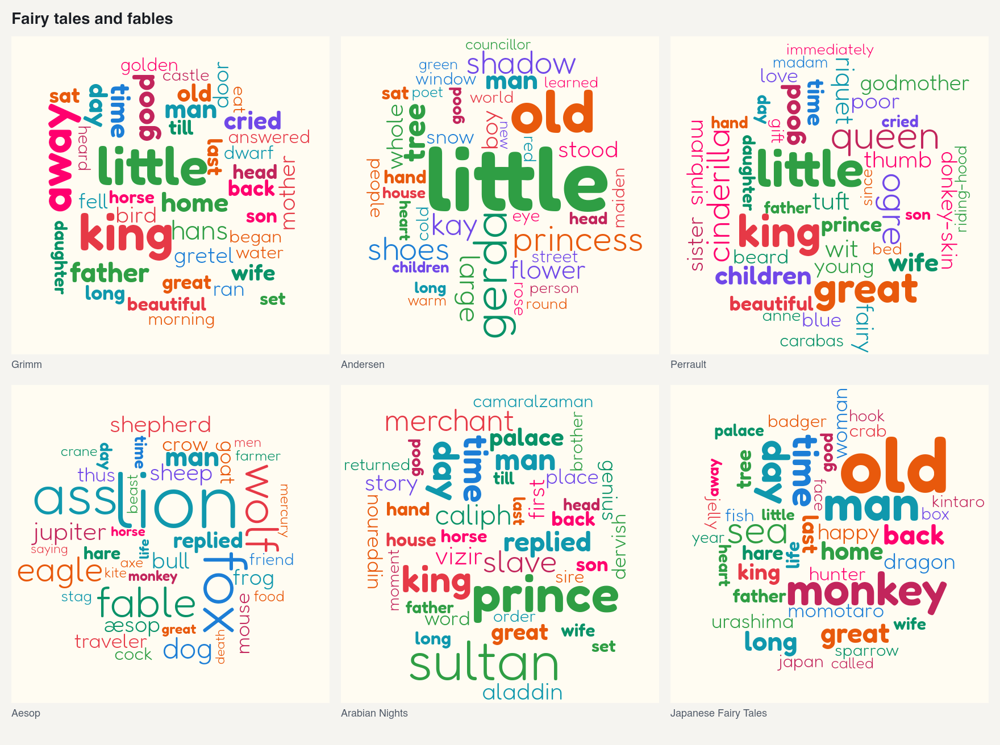
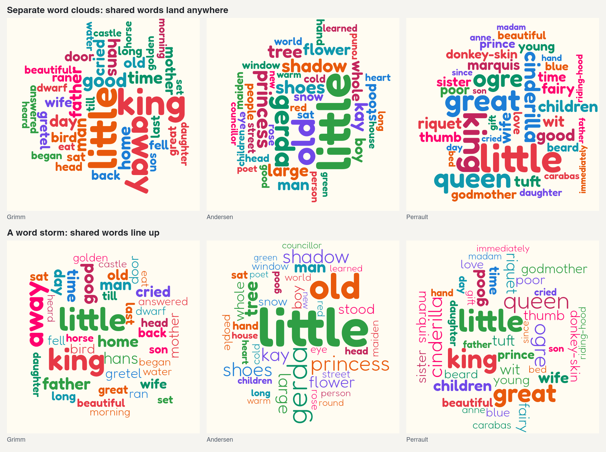

# wordstorms

**Word clouds that line up, so you can compare documents.** Give it a few text
files and it makes one cloud per file, all laid out together. Words the files
share get similar positions and the same color and angle in every cloud, so
you can see at a glance what the documents have in common and what sets each
one apart.



Six collections of fairy tales and fables (`--example fairytales`). Bold words
are in more than one collection's cloud and sit in the same spot in each; thin
words are in only one collection's cloud.

Separate word clouds, made one at a time, put the same word somewhere
different every time. In a word storm it lines up:



Prefer a browser? [wordstorms.org](https://wordstorms.org) does the same, and
your files never leave your computer.

## Usage

You need [Node.js](https://nodejs.org) 22.18 or newer. There's nothing else to
install. Try a built-in example first:

```bash
npx wordstorms --example holmes
```

Then open `wordstorm/index.html` in a browser and hover a word to find it in
every cloud. To compare your own documents:

```bash
# One cloud per .txt or .md file in a folder
npx wordstorms path/to/folder

# Some files, with options
npx wordstorms a.txt b.txt c.txt --words 40 --distinct 30 --palette ocean --out my-storm
```

It writes one SVG and one PNG per cloud into `./wordstorm`, plus that
`index.html`. All the clouds are the same size, so shared words line up when
you stack them, and the SVGs embed their font, so they look the same anywhere.
Each file name becomes its cloud's title. To use word counts from your own
pipeline, give `.json` files like `{"economy": 45, "health": 18}` by name
instead of text files. The other examples are `shakespeare` and `fairytales`.

If you use it often, install it once to get a `wordstorms` command:

```bash
npm install -g wordstorms
wordstorms path/to/folder
```

Word size shows how much a document uses a word compared with the other words
in its own cloud. "Shared" means a word made the top words of more than one
document, so a word missing from a cloud may still be in that document, just
not often enough. [The repository README](https://github.com/quimcastella/wordstorms#reading-a-word-storm)
has more on reading a storm.

## Options

| Option | What it does | Default |
|---|---|---|
| `-o, --out <dir>` | Where to write the files | `./wordstorm` |
| `-f, --format <list>` | Any of `svg`, `png`, `html` and `json`, comma-separated. `storm.json` has every word's position in the same frame as the images, plus the version, font and full options used | `svg,png,html` |
| `--separate` | Lay out each cloud on its own, like an ordinary word cloud, instead of as a storm | |
| `--no-crop` | Keep the full `--size` frame; by default every file is cropped to the words, all to the same frame | |
| `--scale <n>` | PNG pixels per layout pixel, 0.25–8 | 2 |
| `-w, --words <n>` | Words per cloud; common words ("the", "and", "said") are left out, see `--language` | 35 |
| `-d, --distinct <0-100>` | Favor words a document uses more than the others, in %. Unlike tf-idf, words every document uses can still appear, so there are shared words to line up | 20 |
| `--contrast <0.1-3>` | Size differences: 1 is the original scale, higher is more dramatic (the site's slider covers 0.5–1.5) | 1 |
| `--vertical <0-1>` | Share of vertical words | 0.29 |
| `--mark <how>` | Set shared words apart: `none`, `weight` (words in only one cloud are drawn thin) or `warmth` (warm colors for words in several clouds) | `none` |
| `-p, --palette <name>` | `storm`, `ocean`, `sunset`, `crayon`, `forest`, `midnight`, `parchment`, `ink`, `classic` | `storm` |
| `--font <id>` | `oswald`, `bricolage`, `anton`, `fraunces`, `zilla`, `playfair`, `abril`, `fredoka`, `system` | `oswald` |
| `--size <WxH>` | Cloud size in pixels | `640x480` |
| `--language <name>` | `english`, `spanish`, `catalan` or `none`: which common words to leave out and how to clean up word forms. `none` keeps every word as written, single letters included | `english` |
| `--ignore <words>` | Extra words to leave out, comma-separated | |
| `-s, --seed <n>` | Layout number; the same number gives the same layout | 123456 |
| `--example <id>` | Use a built-in example's documents and look instead of files; other options override it | |
| `-v, --version` | Show the version | |

## As a library

The package is also a TypeScript library:

```ts
import { generateStorm, stormToSvg } from 'wordstorms/node';

const storm = generateStorm([
  { name: 'Hamlet', text: hamlet },
  { name: 'Macbeth', text: macbeth },
  { name: 'Survey', words: { economy: 45, education: 32, health: 18 } }, // your own counts
]);
const svg = stormToSvg(storm);
```

`wordstorms/node` measures text with `@napi-rs/canvas` and adds `cloudToPng`.
In browsers, import from `wordstorms`, which has no Node.js dependency and
measures with an `OffscreenCanvas`. The
[repository README](https://github.com/quimcastella/wordstorms#use-it-as-a-library)
has more.

## How it works

Word storms come from the paper
[*Word Storms: Multiples of Word Clouds for Visual Comparison of Documents*](https://arxiv.org/abs/1301.0503)
by Quim Castella and Charles Sutton (WWW 2014). Words that several documents
share are placed first, at the average of their positions across clouds,
then a force layout pulls them toward their spots in similar documents and
pushes overlaps apart. Words only one document uses fill in around them.
[ALGORITHM.md](https://github.com/quimcastella/wordstorms/blob/master/ALGORITHM.md)
has the details.

The source and the site are on
[GitHub](https://github.com/quimcastella/wordstorms). If you use word storms
in your work, please cite the paper (BibTeX is in the repository's README).

## License

Apache 2.0. The fonts are open-source Google Fonts, from Fontsource. The
example texts are in the public domain, from Project Gutenberg.
